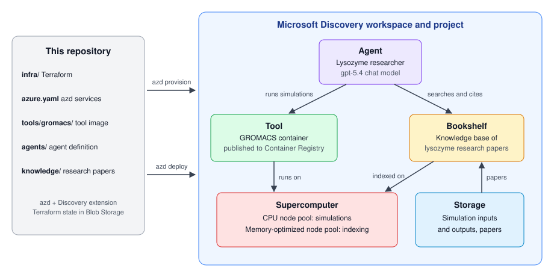

<div align="center">

# Microsoft Discovery GROMACS Sample

**Deploy Microsoft Discovery with Terraform and azd, then run an educational lysozyme-in-water molecular dynamics workflow with a GROMACS tool, a research agent and a Bookshelf knowledge base.**

[](infra)
[](azure.yaml)
[](https://github.com/ikhemissi/azd-microsoft-discovery)

[**Quick start**](#quick-start) · [**Settings**](#settings) · [**Tests**](#tests) · [**Clean up**](#clean-up)

</div>



## What it shows

One repository deploys a complete Microsoft Discovery environment, from the
network to the agent:

| Discovery part | In this sample |
| --- | --- |
| **Infrastructure** | Terraform translation of the official [Discovery deployment quickstart](https://github.com/Azure/azure-quickstart-templates/tree/9a286202372ff9a9a4f4465e1ef30d7b0f3650c6/quickstarts/microsoft.discovery/discovery-infra-deployment): network, identity, storage, container registry, workspace, project and chat model |
| **Supercomputer** | A CPU node pool for simulations and a memory-optimized node pool for indexing, both scaling to zero |
| **Tool** | [GROMACS](tools/gromacs/README.md) container image, built and registered by azd |
| **Storage assets** | A versioned [simulation protocol](experiments/lysozyme-water/README.md) (hand-written MDP files and structure) attached to conversations and mounted into the tool |
| **Bookshelf** | Knowledge base indexed from five open-access lysozyme papers in [knowledge/](knowledge/lysozyme-water) |
| **Agent** | A researcher agent that previews and runs the attached protocol with the GROMACS tool, and cites the knowledge base |

The experiment is an educational baseline, not a validated formulation study.
Deployment uses the community [azd Discovery extension](https://github.com/ikhemissi/azd-microsoft-discovery),
and Terraform state lives in Blob Storage with Entra authentication (no keys or secrets).

| Path | Contents |
| --- | --- |
| [infra/](infra) | Terraform for all Azure and Discovery infrastructure |
| [azure.yaml](azure.yaml) | azd services: `simulation` (tool), `research` (knowledge base), `researcher` (agent) |
| [tools/gromacs/](tools/gromacs) | Tool images (CPU and GPU), the runner and the [experiment](tools/gromacs/README.md) |
| [experiments/](experiments/lysozyme-water) | Versioned simulation protocols: MDP files, structure and checksums |
| [agents/](agents) | Researcher agent definition |
| [knowledge/](knowledge/lysozyme-water) | Research papers, [sources and licenses](knowledge/lysozyme-water/sources.txt) |
| [scripts/](scripts) | Legacy deployment script, kept for reference only |

## Quick start

### 1. Prerequisites

- Complete the [official Discovery prerequisites](https://learn.microsoft.com/azure/microsoft-discovery/quickstart-infrastructure-portal#prerequisites): access, roles, provider registration and regional quota, including [Bookshelf quota](https://learn.microsoft.com/azure/microsoft-discovery/how-to-index-bookshelf-knowledgebase#prerequisites).
- Install [azd](https://learn.microsoft.com/azure/developer/azure-developer-cli/install-azd) ≥ 1.35, [Azure CLI](https://learn.microsoft.com/cli/azure/install-azure-cli), [Terraform](https://developer.hashicorp.com/terraform/install) ≥ 1.5 (≥ 1.11 for tests) and Docker or Podman.
- Run commands in Bash from the repository root.

### 2. Configure the environment

```bash
azd config set auth.useAzCliAuth true   # azd uses your Azure CLI login
az login

SUBSCRIPTION_ID="<subscription-id>"
LOCATION="uksouth"                      # eastus, swedencentral or uksouth
az account set --subscription "$SUBSCRIPTION_ID"

azd env new dev
azd env set AZURE_SUBSCRIPTION_ID "$SUBSCRIPTION_ID"
azd env set AZURE_LOCATION "$LOCATION"
```

### 3. Create the Terraform state storage

Skip to the last two commands if you already have a Blob container where you
have **Storage Blob Data Contributor**.

```bash
STATE_RESOURCE_GROUP="rg-gromacs-tfstate"
STATE_STORAGE_ACCOUNT="<globally-unique-name>"
STATE_CONTAINER="tfstate"

az group create --name "$STATE_RESOURCE_GROUP" --location "$LOCATION"
STATE_ACCOUNT_ID=$(az storage account create \
	--name "$STATE_STORAGE_ACCOUNT" --resource-group "$STATE_RESOURCE_GROUP" \
	--location "$LOCATION" --sku Standard_LRS --kind StorageV2 \
	--https-only true --min-tls-version TLS1_2 \
	--allow-blob-public-access false --allow-shared-key-access false \
	--query id --output tsv)
az role assignment create \
	--assignee-object-id "$(az ad signed-in-user show --query id --output tsv)" \
	--assignee-principal-type User \
	--role "Storage Blob Data Contributor" --scope "$STATE_ACCOUNT_ID"
az storage container create --name "$STATE_CONTAINER" \
	--account-name "$STATE_STORAGE_ACCOUNT" --auth-mode login

azd env set RS_STORAGE_ACCOUNT "$STATE_STORAGE_ACCOUNT"
azd env set RS_CONTAINER_NAME "$STATE_CONTAINER"
```

Role assignments can take a few minutes to propagate, and the storage firewall
must allow your machine.

### 4. Install the azd Discovery extension

```bash
VERSION=0.4.0
azd extension install \
	"https://github.com/ikhemissi/azd-microsoft-discovery/releases/download/v${VERSION}/ikhemissi-azd-discovery_${VERSION}.zip"
azd discovery version
```

The extension is community-maintained, not officially supported by Microsoft.
See its [README](https://github.com/ikhemissi/azd-microsoft-discovery) for
updates and other platforms.

### 5. Provision and deploy

Provisioning creates billable resources. Review the preview first.

```bash
export AZD_CONTAINER_RUNTIME=podman   # only if using Podman instead of Docker

azd provision --preview
azd provision
```

The agent can only attach the knowledge base once it is indexed, so on a new
environment deploy in this order:

```bash
# Tool and knowledge base
azd deploy simulation
azd discovery data upload lysozyme-water --dry-run
azd discovery data upload lysozyme-water --confirm
azd deploy research

# Index the papers (billable; runs on the indexing node pool)
azd env set DISCOVERY_INDEX_MIN_NODES 1 && azd provision
azd discovery index research
azd env set DISCOVERY_INDEX_MIN_NODES 0 && azd provision

# Agent, with the tool and knowledge base attached
azd deploy researcher

# Simulation protocol, attached to conversations that run simulations
azd discovery data upload lysozyme-water-protocol --dry-run
azd discovery data upload lysozyme-water-protocol --confirm
```

After the first indexing, `azd deploy --all` (or `azd up`) redeploys everything.
Rerunning a command after an interruption resumes it without duplicating work.

### 6. Try it

Open [Discovery Studio](https://studio.discovery.microsoft.com), select the
project, and ask the researcher agent, for example:

> According to the papers in the knowledge base, which structural measures do
> MD studies of hen egg-white lysozyme in water use to assess stability, and
> which does this sample's runner produce? Cite the papers.

The agent should search the knowledge base and cite the papers.

To run a simulation, start a conversation with the agent, attach the
`lysozyme-protocol-v1` storage asset, and ask:

> Run the attached lysozyme-in-water protocol as a technical smoke test with the
> default seed. Show me the protocol version and its stage parameters first.

The agent reads the MDP files, summarizes the protocol and asks for
confirmation before submitting the billable job. The smoke profile takes a few
minutes on the CPU node pool and is a technical check, not a scientific result.

## Settings

Optional overrides, set with `azd env set NAME VALUE` before `azd provision`:

| Variable | Default | Purpose |
| --- | --- | --- |
| `DISCOVERY_DATA_PLANE_LOCATION` | `AZURE_LOCATION` | Region for networking, identity, storage and Discovery-managed resources |
| `DISCOVERY_VNET_ADDRESS_PREFIX` | `10.0.0.0/16` | IPv4 /16; six /24 subnets are allocated |
| `DISCOVERY_STORAGE_REPLICATION` | `GRS` | `LRS`, `ZRS`, `GRS`, `GZRS`, `RAGRS` or `RAGZRS` |
| `DISCOVERY_VM_SIZE` | `Standard_D4s_v6` | Simulation node pool VM size (CPU) |
| `DISCOVERY_MIN_NODES` / `DISCOVERY_MAX_NODES` | `0` / `3` | Simulation node pool size |
| `DISCOVERY_NODE_PRIORITY` | `Regular` | `Regular` or `Spot` |
| `DISCOVERY_INDEX_VM_SIZE` | `Standard_E20s_v6` | Indexing node pool VM size (memory-optimized) |
| `DISCOVERY_INDEX_MIN_NODES` / `DISCOVERY_INDEX_MAX_NODES` | `0` / `1` | Indexing node pool size |
| `DISCOVERY_CHAT_MODEL` / `DISCOVERY_CHAT_DEPLOYMENT` | `gpt-5.4` / `gpt-5-4` | Chat model and deployment name |
| `DISCOVERY_BOOKSHELF_PUBLIC_ACCESS` | `Enabled` | `Disabled` blocks Discovery Studio unless you add a private endpoint |
| `DISCOVERY_NETWORK_ISOLATION` | `true` | Workspace isolation tag |
| `DISCOVERY_ENABLE_GHCP_AI` / `DISCOVERY_ENABLE_EXTENSIONS` | `true` / `true` | Workbench feature tags (GitHub Copilot and AI features are in preview) |
| `DISCOVERY_ASSIGN_PROVISIONER_DATA_ROLES` | `false` | Grant your account Discovery and outputs-container data access (see below) |

Tags for all resources are set with `global_tags` in [infra/main.tfvars.json](infra/main.tfvars.json).
Discovery tags are immutable, so changing them can recreate resources, and
changing the region of an existing environment can too; always check the preview.

**Provisioner data roles:** with `DISCOVERY_ASSIGN_PROVISIONER_DATA_ROLES=true`,
Terraform grants the provisioning account **Microsoft Discovery Platform
Contributor** on the resource group and **Storage Blob Data Contributor** on the
`discoveryoutputs` container. If these grants already exist, import them into
`azurerm_role_assignment.provisioner["discovery_platform_contributor"]` and
`azurerm_role_assignment.provisioner["storage_blob_data_contributor"]` first.
Setting the flag back to `false` removes them.

**Permissions:** Terraform grants the provisioning account **AcrPush** on the
registry (to publish the tool image) and **Storage Blob Data Contributor** on
the papers container (to upload them). The Discovery identity pulls images and
reads the papers through Terraform-managed grants. The extension never grants
roles, scales compute or runs simulations.

## Tests

Mocked tests check configuration without Azure credentials or deployments:

```bash
terraform -chdir=infra init -backend=false
terraform -chdir=infra fmt -check -recursive
terraform -chdir=infra validate
terraform -chdir=infra test
azd discovery plan --output json   # after provisioning
```

## Clean up

**Back up any simulation outputs first**, then delete the environment:

```bash
azd down
```

The Terraform state storage is not deleted; remove it when no environment uses it.

## Learn more

- [GROMACS experiment](tools/gromacs/README.md)
- [azd Discovery extension](https://github.com/ikhemissi/azd-microsoft-discovery)
- [Microsoft Discovery documentation](https://learn.microsoft.com/azure/microsoft-discovery/)
- [Bookshelf and knowledge bases](https://learn.microsoft.com/azure/microsoft-discovery/concept-bookshelf-knowledge-bases)
- [Use Terraform with azd](https://learn.microsoft.com/azure/developer/azure-developer-cli/use-terraform-for-azd)
