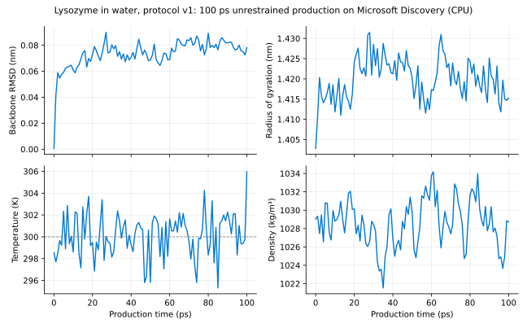
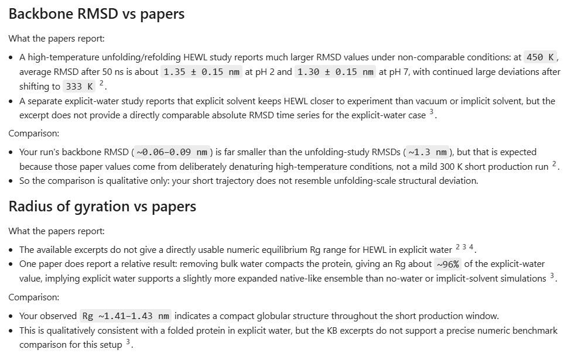

# The lysozyme-in-water experiment

## Purpose

Learn the research workflow on a small public protein before adding an ingredient.
The question is: **how does lysozyme move in water during a short simulation?**
GROMACS calculates molecular motion; Discovery organizes the inputs, invokes
the tool and helps explain its outputs. This is an educational baseline, not a
validated formulation study or evidence of protein protection.

The first milestone is a complete water-only run. Glycerol comparisons are the
[second milestone](#next-add-glycerol) and are not implemented yet.

## Inputs and assumptions

| Item | Baseline choice |
| --- | --- |
| Protein | Hen egg-white lysozyme, public PDB entry 1AKI, chain A, 129 residues. |
| Preparation | Keep protein ATOM records; remove crystallographic waters; rebuild hydrogens with GROMACS. Unexpected alternate locations or a changed source checksum stop preparation. |
| Molecular parameters | GROMACS-bundled OPLS-AA protein parameters and SPC/E water. These are explicit choices, not the upstream helper's CHARMM defaults. |
| Chemistry | Standard `pdb2gmx` protonation and terminus assignments and geometry-detected disulfides; no explicit pH model. Review these assignments before scientific use. |
| Disulfides | Expect Cys6-Cys127, Cys30-Cys115, Cys64-Cys80 and Cys76-Cys94. Confirm them in the preparation log and topology. |
| Solvent | Water and neutralizing counterions only; no added salt or glycerol. |
| Box | Dodecahedron with 1.0 nm initial protein-to-box clearance. |
| Conditions | 300 K; 1 bar during pressure equilibration and production. |
| Minimization | Steepest descent, up to 50,000 steps, force threshold 1,000 kJ/mol/nm. Failure to reach it stops the run. |
| Equilibration | 100 ps at fixed volume, then 100 ps at controlled pressure, with protein position restraints. |
| Production | 100 ps without position restraints: 50,000 steps at 0.002 ps per step. This is not sufficient to establish equilibrium or formulation efficacy. |
| Outputs | Coordinates and energies every 1 ps; fixed velocity and ion-placement seed; two CPU threads by default. |

The parameters live in the versioned [protocol bundle](../experiments/lysozyme-water/README.md).
The ion-placement input uses a cutoff electrostatic calculation solely to generate
the temporary input for replacing waters with ions. Minimization and dynamics use
PME electrostatics. No preprocessing warnings are bypassed. Numerical instabilities
stop the workflow rather than trigger silent changes to the scientific protocol.

## Results

The researcher agent ran protocol v1 as written (`run` profile, seed `20261008`)
on a `Standard_D4s_v6` node (4 vCPUs, 2 CPU threads used) in Microsoft Discovery. It completed in 42 minutes and
all checksums passed. Over the 100 ps unrestrained production:

| Measure | Value |
| --- | --- |
| Backbone RMSD | Rises to about 0.08 nm within 30 ps and levels off (maximum 0.090 nm) |
| Radius of gyration | 1.403–1.432 nm, mean 1.420 nm, no trend |
| Temperature, 50–100 ps | 300.3 ± 2.1 K (target 300 K) |
| Density, 50–100 ps | 1029 ± 3 kg/m³ |
| Pressure, 50–100 ps | 35 ± 158 bar (instantaneous pressure fluctuates strongly) |

The protein stays compact and close to the crystal structure, and the thermostat
and barostat hold their targets. That is what a working setup should show, and
nothing more: 100 ps is far shorter than the nanosecond to sub-millisecond simulations
in the [knowledge base papers](../knowledge/lysozyme-water/sources.txt), and a
single trajectory has no uncertainty estimate.

Asked to compare these results with the papers, the agent reached the same
conclusion and kept the comparison qualitative:

Check the agent's citations against [sources.txt](../knowledge/lysozyme-water/sources.txt):
in our test it attributed one paper to the wrong authors in its reference list.

## Interpreting results

The runner's outputs are listed in the [tool README](../tools/gromacs/README.md#inspect-the-results).
Before interpretation, check all stages, not just production plots: correct
protein and disulfides, sensible density and temperature, absence of instability,
trajectory continuity and no systematic drift. Instantaneous pressure fluctuates
strongly in small systems; do not demand every frame equal 1 bar. The runner's
checks are necessary technical checks, not a complete equilibration assessment.

An unchanged protein over 100 ps does not demonstrate protection, thermodynamic
stability or retained activity. Differences between individual short trajectories
can be sampling noise. Preserve inconclusive results rather than force a ranking.

## Next: add glycerol

The proposed comparison is 0%, 10% and 20% glycerol by **solvent mass**:
glycerol mass divided by the combined water and glycerol mass, excluding protein
and ions. Do not substitute molecule counts or solution volume percentages.

Before implementation, an MD-experienced reviewer should approve glycerol
parameters compatible with the protein and water force field, protonation,
temperature, salt conditions, box composition and equilibration and convergence
criteria. Allocate at least three independent replicas per condition and choose
durations based on the question and sampling evidence, not the 100 ps
demonstration setting. Add hydration and protein-glycerol interaction analyses;
compare uncertainty, not only trajectories. A second review should approve
conclusions before presentation.

## Literature and provenance

- [PDB 1AKI](https://www.rcsb.org/structure/1AKI): public starting coordinates,
  1.5 angstrom X-ray structure, not a prepared simulation system.
- [Upstream lysozyme inputs](https://github.com/microsoft/discovery/tree/ddecc27bba4e3dec2a47f7f9a3c4f143a0c89b6d/agents/gromacs/tools/gromacs/example-input-files/lysozyme):
  workflow inspiration. This sample uses its own explicit OPLS-AA/SPC/E protocol,
  C-rescale pressure coupling, all-bond constraints and 100 ps stage durations.
- Ghattyvenkatakrishna and Carri (2014),
  [Effect of glycerol-water binary mixtures on the structure and dynamics of protein solutions](https://doi.org/10.1080/07391102.2013.773562):
  published 20 ns lysozyme simulations at 0%, 10%, 20%, 30% and 100% glycerol by
  weight. This motivates stage two; the current baseline is not a reproduction
  of its methods or results.
- [GROMACS parameter reference](https://manual.gromacs.org/2025.2/user-guide/mdp-options.html):
  definitions and units of the simulation settings.
- The [knowledge base papers](../knowledge/lysozyme-water/sources.txt) the agent cites.
