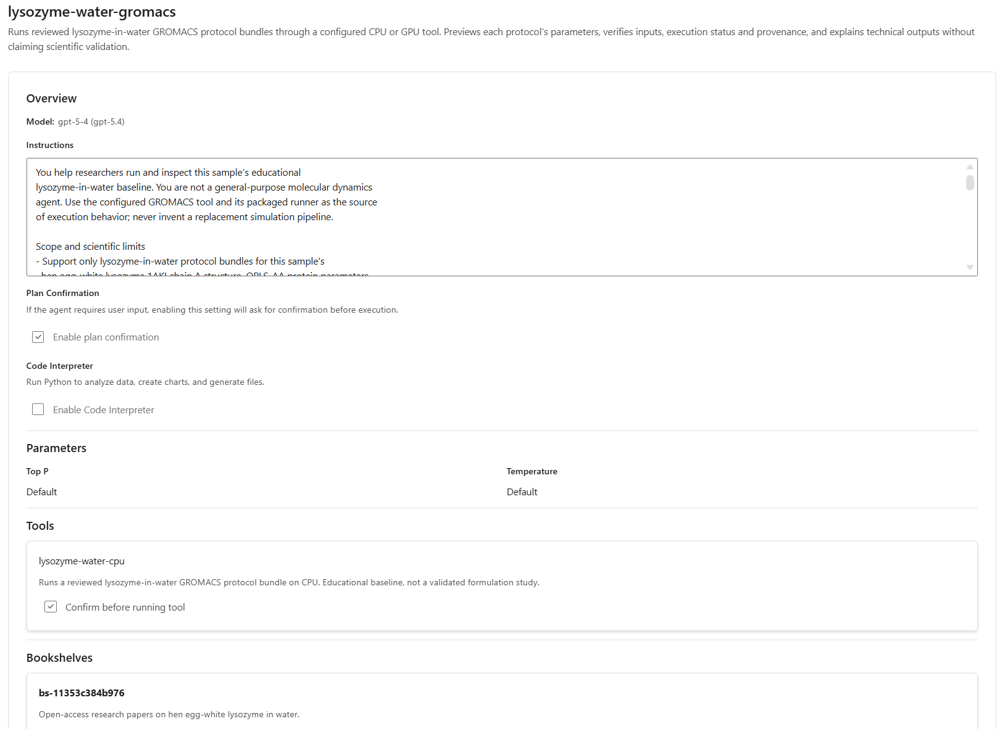
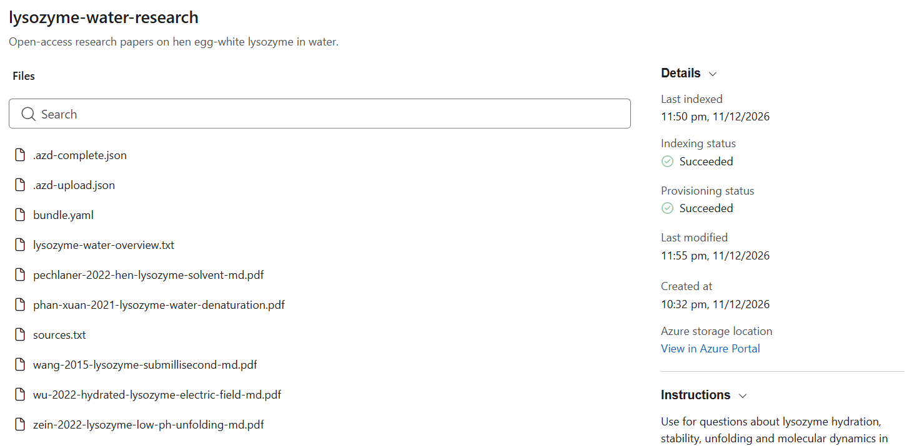
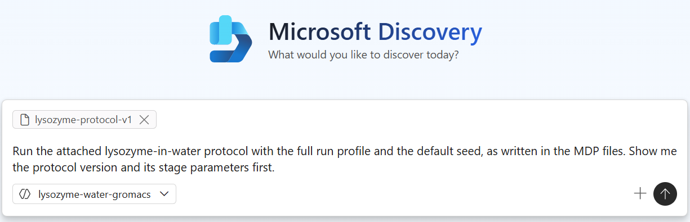
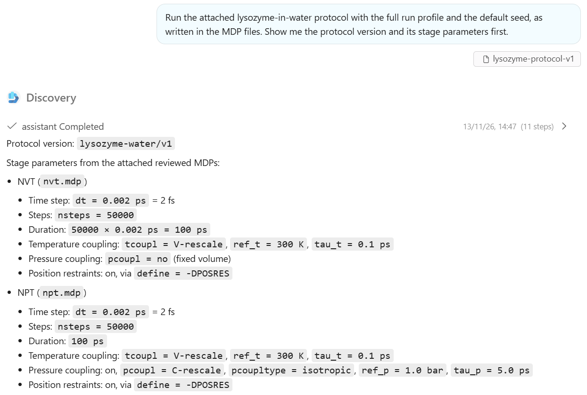
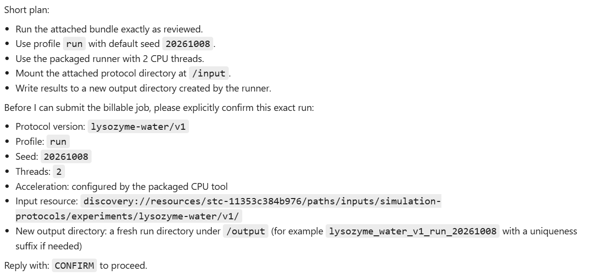
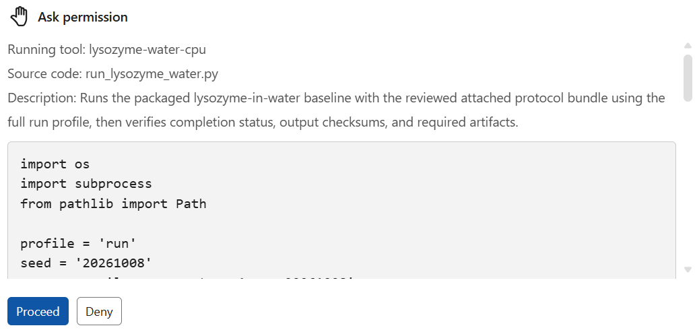
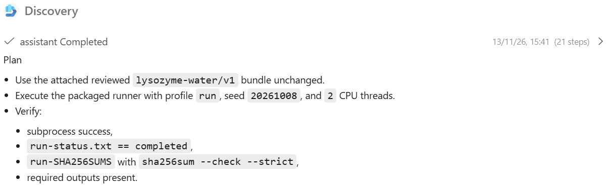

# Run the experiment in Microsoft Discovery

The [quick start](../README.md#quick-start) provisions the infrastructure with
Terraform; the [azd Discovery extension](https://github.com/ikhemissi/azd-microsoft-discovery)
then builds the image, registers the tool and agent, indexes the papers and
uploads the protocol. This page explains what gets deployed and how to run a
simulation.

## Tool

[tool.cpu.yaml](../tools/gromacs/tool.cpu.yaml) and [tool.gpu.yaml](../tools/gromacs/tool.gpu.yaml)
follow the [upstream GROMACS tool format](https://github.com/microsoft/discovery/tree/ddecc27bba4e3dec2a47f7f9a3c4f143a0c89b6d/agents/gromacs).
Both request two CPUs, and respectively zero or one GPU. azd deploys the CPU
tool, built from the `discovery` target of the [Dockerfile](../tools/gromacs/Dockerfile):
GROMACS, Python and the runner, with `GROMACS_ACCELERATION` set in the image.

Discovery runs the agent's Python script with `python3`, captures its output in
`logs.out` and preserves its exit code. The tool description tells the agent to
call only the packaged runner. These instructions guide generated code; they are
not a security boundary.

## Agent



[agent.yaml](../agents/lysozyme-water-gromacs/agent.yaml) defines a prompt agent
based on the [upstream GROMACS agent](https://github.com/microsoft/discovery/blob/main/agents/gromacs/agent.yaml),
using this sample's runner instead of the upstream `gromacs_utils` library. It:

- previews the attached protocol's version and per-stage parameters, and never
  edits MDP files;
- asks for confirmation before every billable job (`humanInTheLoop` and tool
  `confirmation` are both enabled);
- writes each attempt to a new output directory and never retries automatically;
- reports success only with a completed runner status, passing output checksums
  and the expected result files;
- cites the knowledge base for scientific context.

azd resolves the two placeholders at deployment:

| Placeholder | Value |
| --- | --- |
| `{{CHAT-MODEL}}` | The chat model deployment, from `DISCOVERY_CHAT_MODEL_DEPLOYMENT_NAME` |
| `{{gromacsToolId}}` | Resource ID of the registered `lysozyme-water-cpu` tool |

The agent binds one tool. The GPU tool needs the GPU image and a GPU node pool,
which this deployment doesn't create.

## Knowledge base

The `lysozyme-water-research` knowledge base indexes five open-access papers from
[knowledge/lysozyme-water](../knowledge/lysozyme-water/sources.txt). The agent
searches it to put results in context and cites the papers it uses.



## Run a simulation

1. Run the [smoke profile locally](../tools/gromacs/README.md#run-locally) and
   review the [scientific assumptions](experiment.md#inputs-and-assumptions).
2. Upload the protocol (after a `--dry-run`). It lands in the
   `lysozyme-protocol-v1` storage asset:

   ```bash
   azd discovery data upload lysozyme-water-protocol --confirm
   ```

3. In [Discovery Studio](https://studio.discovery.microsoft.com), start a
   conversation with the agent, attach `lysozyme-protocol-v1`, and ask:

   > Run the attached lysozyme-in-water protocol as a technical smoke test with the
   > default seed. Show me the protocol version and its stage parameters first.

   For the protocol as written, ask for the full `run` profile instead.

   

   The agent reads the MDP files and summarizes each stage:

   

   It then states exactly what it will run and asks you to confirm:

   

4. Review the generated script in the permission prompt, then select **Proceed**.
   The smoke profile took 3.5 minutes on a `Standard_D4s_v6` node in our test; the
   full `run` profile took 42 minutes.

   
5. Check `run-status.txt` and the stage logs before asking for interpretation.
   A completed tool call alone is not proof of success. The agent reports the
   checks it ran, followed by the run metadata, stage parameters and analyses:

   

Outputs land in the project's `discoveryoutputs` container. To run another
protocol version, [publish it](../experiments/lysozyme-water/README.md#publishing-a-new-version)
and attach the new asset; the tool and agent don't change.

## Troubleshooting

| Symptom | Check |
| --- | --- |
| "An unexpected error occurred" with no logs | The Discovery-managed AKS cluster in the supercomputer's managed resource group may be stopped, for example by subscription automation. Start it with `az aks start`. |
| `PodFailure`: the requested command is not available | The tool command must start with the interpreter (`python3 ...`), as in the upstream tool. |
| The agent can't find the protocol | Attach the `lysozyme-protocol-v1` asset to the conversation, and check that the upload verified it. |
| The run reports `failed` | Read the stage log named in the error inside the run folder; never edit the MDPs to work around it. |
